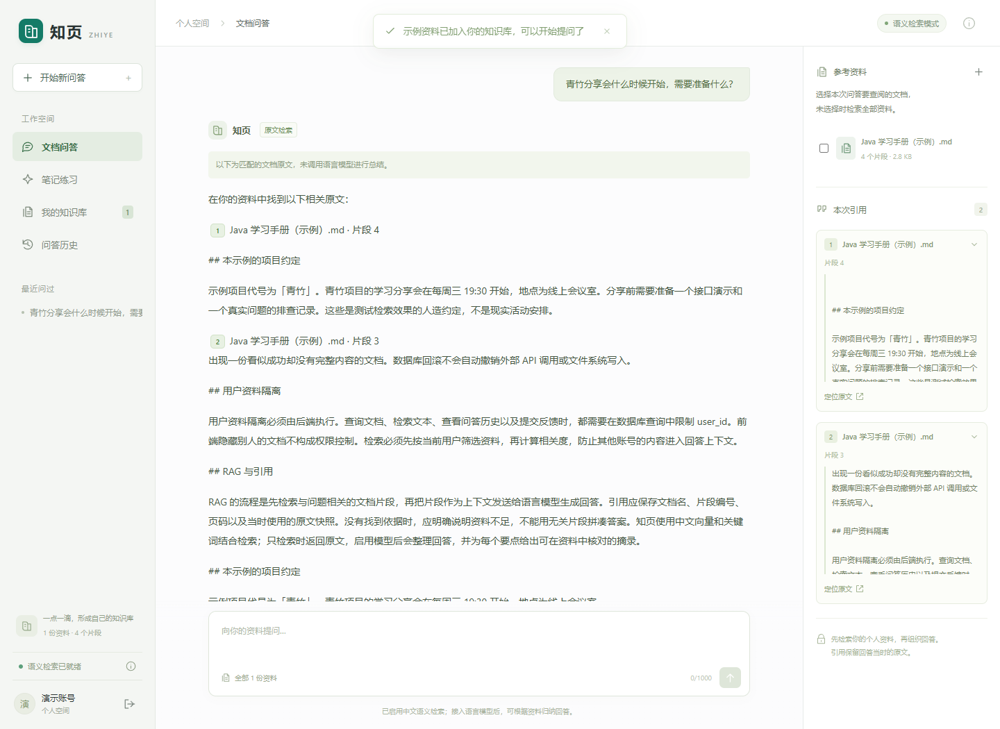
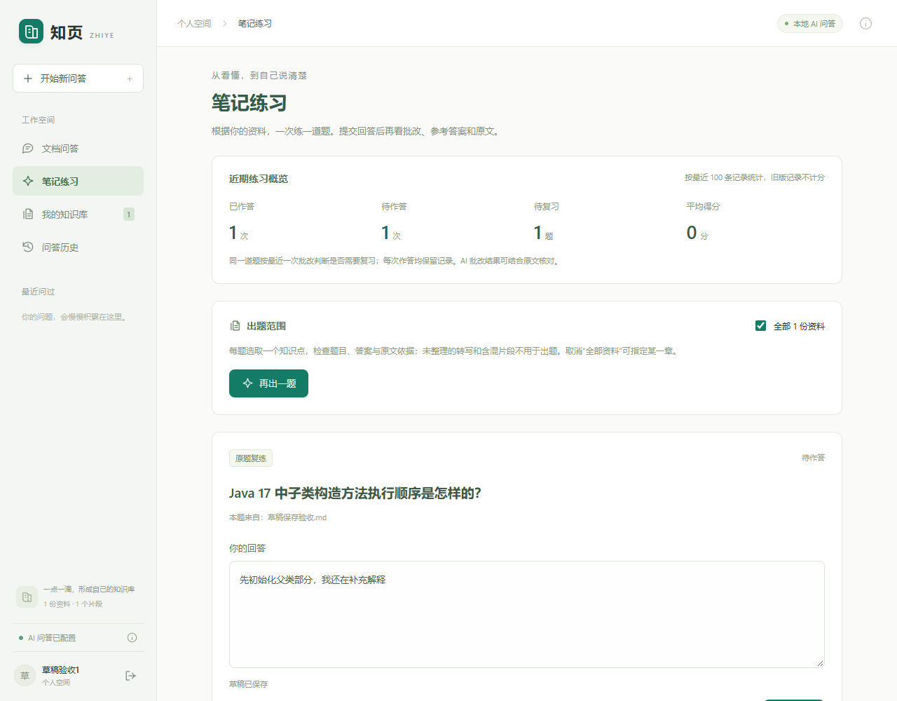

# 知页 · Java 文档知识库

把 PDF、TXT 和 Markdown 资料变成可以查原文、做练习的个人学习资料库。

这是一个使用 AI 辅助开发和迭代的 Java + Vue 学习项目，围绕“上传资料 → 检索问答 → 核对引用 → 出题作答 → 错题复练”实现可运行的学习流程。默认可用 H2 和本地检索启动；接入模型后，再启用生成回答、出题和批改。

## 功能

| 模块 | 已实现内容 |
| --- | --- |
| 账号与隔离 | 注册、登录、会话令牌；资料、问答和练习按用户隔离 |
| 资料管理 | PDF / UTF-8 TXT / Markdown 上传、去重、解析切分、预览和删除；可导入手动从 Notion 导出的 Markdown |
| 混合检索 | 中文 BGE 向量 + BM25 关键词检索，以 RRF 融合候选；可限定资料范围 |
| 原文引用 | 文档名、PDF 页码、片段编号和原文摘录；问答保留当时的引用快照 |
| 模型问答 | 通过 LangChain4j 调用本地 Qwen 或兼容接口；按回答要点核对引用编号与连续原文摘录 |
| 笔记练习 | 根据资料一次出一道简答题；提交后显示逐项批改、参考答案与依据；旧版未审校记录暂停展示参考答案和评分 |
| 复习与草稿 | 原题再练、待复习 / 已掌握筛选、近期学习概览；草稿自动保存、刷新恢复及多页面编辑冲突处理 |
| 历史与反馈 | 问答历史、正负反馈与撤销、单条删除；文档索引和业务数据持久化 |

## 页面预览

以下页面使用演示资料展示功能。





## 快速开始：先运行检索模式

当前提供的启动脚本面向 **Windows PowerShell**。需要 Java 17、Maven 3.6.3+、Node.js 22.12+（或 20.19+），并确保 `java`、`mvn.cmd`、`npm.cmd` 在 PATH 中可用。

在下载后的项目根目录运行：

```powershell
cd "<项目下载目录>"
.\scripts\build.ps1
.\scripts\start.ps1 -Mode retrieval -Database h2
```

首次构建需要联网下载 Maven / npm 依赖与中文向量模型依赖。此模式使用 Java 进程内的中文向量检索和 H2 文件数据库，**不需要大模型 API、本地 Qwen 或 MySQL**。

打开 [http://127.0.0.1:8088](http://127.0.0.1:8088)，创建自己的账号；项目没有预置账号和密码。点击“导入示例，试一试”，再提问“青竹分享会什么时候开始？”，即可检查原文检索和引用。

检索模式返回相关原文；生成式回答、出题和批改需要下一节的模型配置。服务在前台运行，按 `Ctrl+C` 停止。日常操作也可使用根目录的“启动知页 / 停止知页 / 检查知页”入口。

## 可选：启用本地模型与练习

先停止上一步的前台服务，再在项目根目录运行：

```powershell
.\scripts\setup-local-ai.ps1
.\scripts\start.ps1 -Mode local-ai -Database h2
```

配套方案面向 **Windows x64**，使用 Qwen3 4B Q4_K_M 与 Vulkan 运行程序，需要兼容的 GPU、Vulkan 驱动以及可访问下载源的网络。权重约 2.5 GB；运行速度和内存、显存占用取决于机器配置。下载脚本核对固定版本的 SHA-256。本地生成模型运行在 `127.0.0.1:18081`，应用仍使用 8088。

模型启动后，可进入“笔记练习”，选择资料、出题并作答。停止输入约 0.8 秒后自动保存草稿；刷新或返回练习页可继续上次未提交的题目。提交后查看批改，再通过“原题再练”重新回答，每次结果单独保留。

也可接入支持 Chat Completions 和 JSON 输出的兼容服务。环境变量参考 [.env.example](.env.example)，该文件不会被自动加载；具体配置见[运行与开发记录](docs/operations.md#使用自己的模型服务)。密钥仅配置在后端启动环境中。

H2 可用于完整的本地学习流程。MySQL 为可选路线，需要现有的 MySQL 8.x 安装且 `mysqld.exe` 可用；脚本建立项目专用实例，中文工作目录会通过核对后的 ASCII 临时路径别名访问数据。配置、H2 数据迁移及备份恢复详见[MySQL 配置](docs/operations.md#mysql-配置)。

## 技术与代码入口

| 层次 | 技术 |
| --- | --- |
| 后端 | Java 17、Spring Boot 3.5、Spring Security、MyBatis |
| 前端 | Vue 3、TypeScript、Vite |
| 数据与解析 | H2 / MySQL、PDFBox |
| 检索与模型 | 中文 BGE-small-zh-v1.5、BM25、RRF、LangChain4j、本地 Qwen3 或兼容接口 |

向量存放在普通数据库表中，由 Java 计算相似度；当前实现面向小型个人知识库。

| 调用链 | 主要入口 |
| --- | --- |
| 上传与索引 | `frontend/src/App.vue` → `DocumentController` → `DocumentService` → `DocumentParser / VectorIndexService` → Mapper |
| 检索与回答 | `App.vue` → `QuestionController` → `QuestionService` → `HybridRetriever` → 可选的 `ModelGateway` → `AnswerMapper` |
| 出题、批改与草稿 | `frontend/src/PracticePanel.vue` → `PracticeController` → `PracticeService` → `PracticeModel / ExerciseMapper` |

后端代码位于 `backend/src/main/java/cn/knowledge/`，建表脚本位于 `backend/src/main/resources/schema.sql`。仓库包含后端业务、模型协议及前端异步状态回归测试；构建脚本会执行普通回归、类型检查并打包前端与后端。真实模型和 MySQL 验证需要另外准备对应环境，操作说明保留在[运行与开发记录](docs/operations.md#代码入口与验证)中。

2026-10-23 已在独立源码目录完成构建、全新 H2 启动、示例导入、无生成模型的检索、原文定位和历史保存验证：38 项前端与 84 项普通后端检查通过，81 项依赖额外 MySQL / 模型环境的检查按设计跳过。本次仅复用了 Maven / npm 依赖缓存，没有复用业务数据、运行配置或 Qwen 权重；未将此结果视为全新电脑首次联网下载的验证。

前后端分别启动的开发方式也见[运行与开发记录](docs/operations.md#运行)。

## 使用边界

- 面向个人学习和本地演示，默认只监听 `127.0.0.1`，未做生产规模或公网部署验收。
- 每个账号最多 50 份资料；单份最多 10 MB、提取文本最多 12 万字符、PDF 最多 100 页。只保存解析文字与元数据，不保留原始附件。
- 不支持扫描件 OCR、DOCX、图片识别、多轮追问，也不提供 Notion 自动同步。
- 问答历史与练习列表最多显示最近 100 条；学习概览和错题筛选也按最近 100 条保留记录计算。平均分按已批改的作答次数计算，旧版未审校记录不计分。
- 模型即使通过格式与摘录检查，仍可能概括错误或误判评分；需要结合原文核对。检索得分不是答案置信度。
- 删除资料后，已有问答与练习仍保留当时的原文快照；彻底清除内容时需同时删除相关记录。

公开仓库只包含源码、示例和展示材料。本地运行数据、账号凭据、模型、缓存及个人资料不属于源码交付范围。
